# claude-mods

Claude Code mods by Niket.

```
/plugin install buddy --marketplace niketmittal/claude-mods
/plugin install eta --marketplace niketmittal/claude-mods
/plugin install fold --marketplace niketmittal/claude-mods
```

## buddy

Clawd, the block mascot from Claude Code's welcome screen, lives on every prompt you type. Each prompt gets its own Clawd: its own color, its own hat, and something to do that fits what you asked. Scrolling back through a long session, your prompts are easy to spot.


The moment you send a prompt, its Clawd starts on the activity that fits it. Then it walks the row, turns around, does one of Claude Code's own Clawd tricks on the way back, and starts the next lap. A prompt that matches several topics does them one per lap, the item popping in with a sparkle and leaving in a puff; a prompt with no topic gets a new activity, scene and sometimes a crew every lap. The topics come from what people most often ask Claude Code for.

| | |
| --- | --- |
| 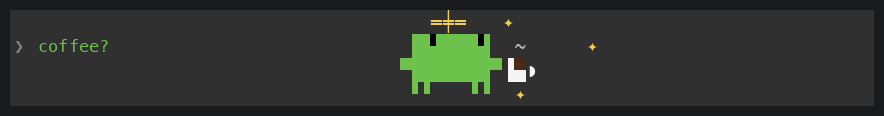<br>`coffee`, `mug`: sips from a mug | 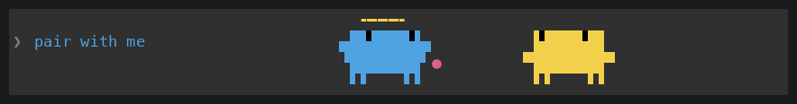<br>`pair`, `play`, `collab`: plays catch with a friend |
| 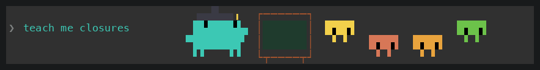<br>`teach`, `explain`, `learn`: teaches a class of tiny Clawds | 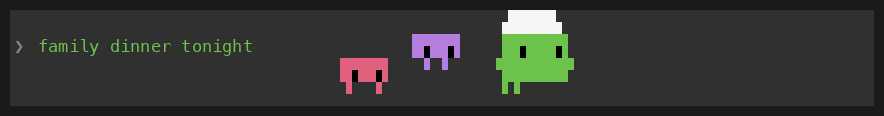<br>`family`, `team`, `friends`: tiny Clawds hop along behind |
| 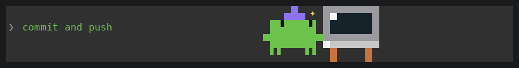<br>`git`, `commit`, `laptop`: types code on a laptop | 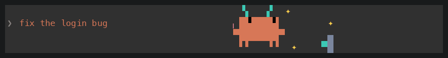<br>`fix`, `build`, `hammer`: hammers a nail into a board |
| 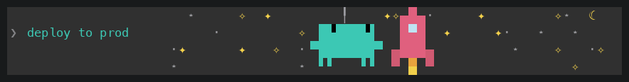<br>`deploy`, `ship`, `rocket`: launches a rocket into space | 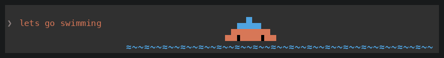<br>`swim`, `beach`, `water`: swims through the waves |
| 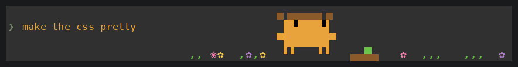<br>`design`, `css`, `pretty`: grows a flower in a garden | 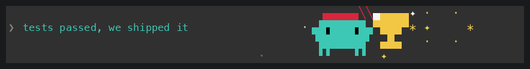<br>`passed`, `merged`, `shipped`: trophy and fireworks |
| 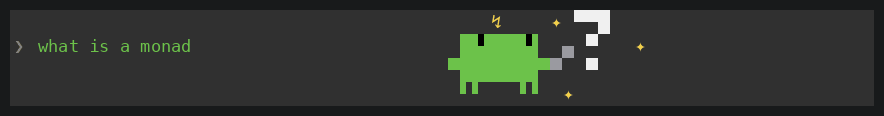<br>a question: thought bubble ? → … → ! | 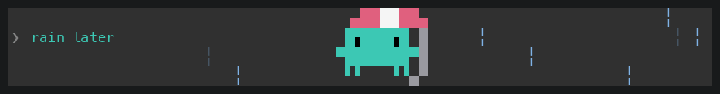<br>`rain`, `umbrella`: an umbrella in the rain |
| 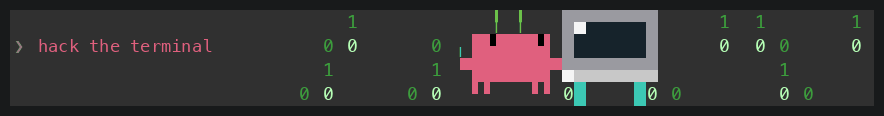<br>`code`, `hack`, `terminal`: falling matrix code | 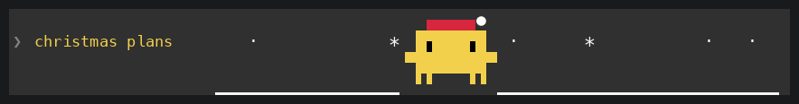<br>`christmas`, `snow`: santa hat in the snow |
| 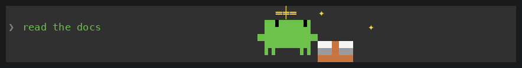<br>`read`, `docs`, `book`: reads, pages turning | 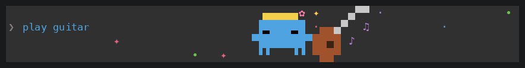<br>`guitar`, `song`, `band`: plays guitar |
| 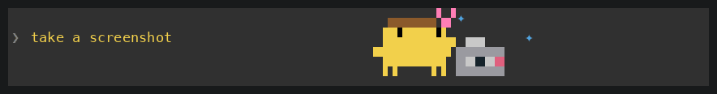<br>`screenshot`, `photo`: camera flash | 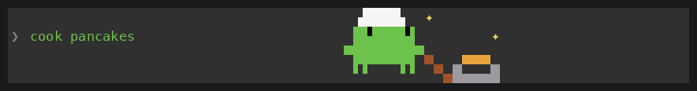<br>`cook`, `recipe`, `pancake`: flips a pancake |
| 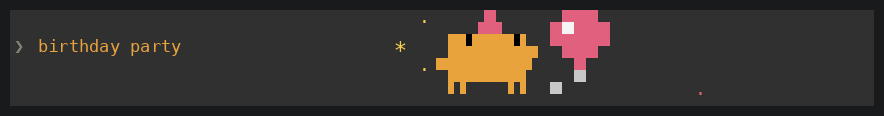<br>`birthday`, `balloon`: party hat and a balloon | 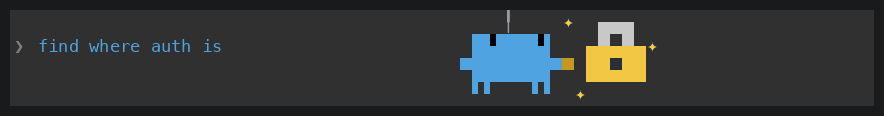<br>`find`, `search`, `debug`: scans with a magnifier |
| 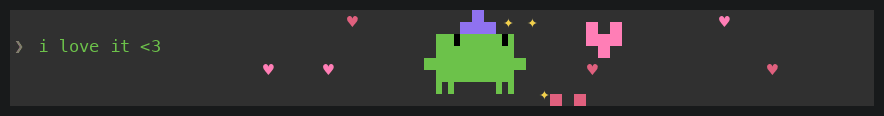<br>`love`, `heart`, `<3`: hearts float up | 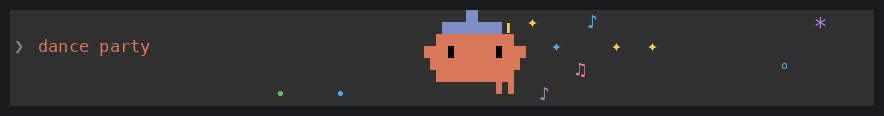<br>`dance`, `music`, `party`: dances to music |
| 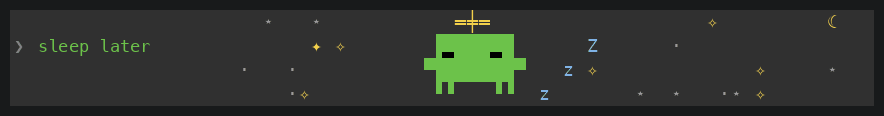<br>`sleep`, `later`, `tired`: naps under the moon | 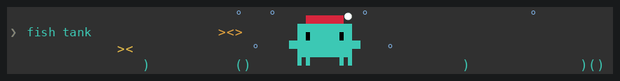<br>`fish`, `dive`: bubbles, fish and seaweed |
| 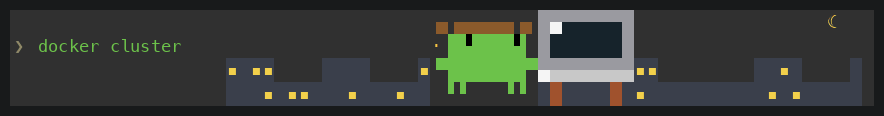<br>`docker`, `k8s`, `server`: laptop before a city skyline | 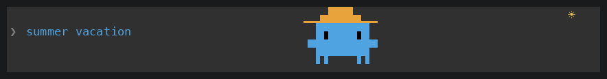<br>`summer`, `vacation`: sombrero in the sun |
| 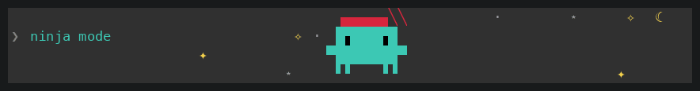<br>`ninja`, `secret`: ninja at night | 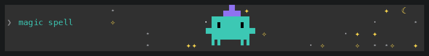<br>`magic`, `wizard`, `spell`: wizard among the stars |
| 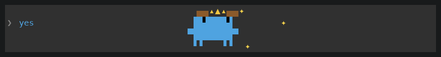<br>`yes`, `ok`, `go`: a check mark draws itself | 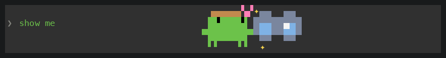<br>`show`, `open`, `view`: looks through binoculars |
| 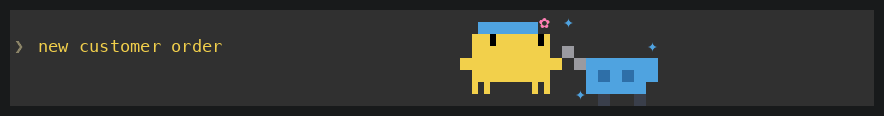<br>`shop`, `order`, `customer`: a cart fills with parcels | 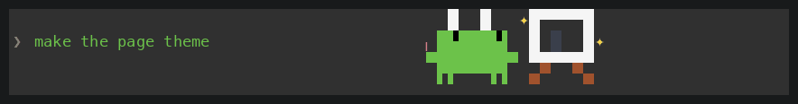<br>`page`, `button`, `theme`, `ui`: paints a canvas |
| 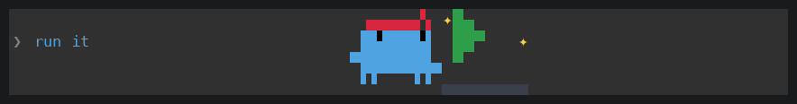<br>`run`, `start`, `execute`: play, progress bar, done | 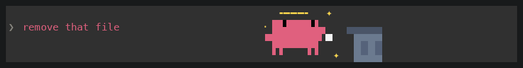<br>`remove`, `delete`, `clean`: tosses paper in the bin |
| 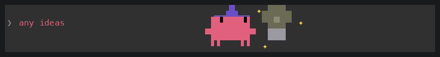<br>`plan`, `idea`, `brainstorm`: a light bulb flickers on | 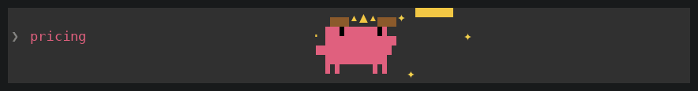<br>`payment`, `pricing`, `money`: coins stack up |
| 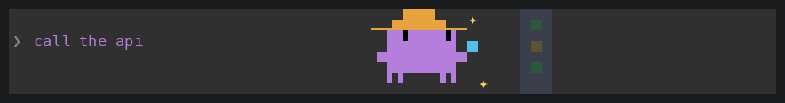<br>`api`, `request`, `webhook`: request out, response back | 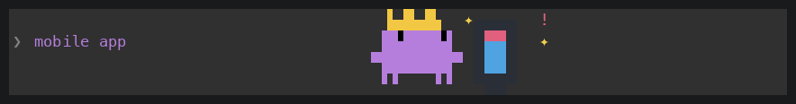<br>`phone`, `mobile`, `app`: a buzzing phone |
| 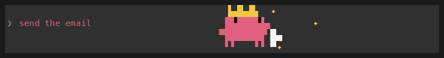<br>`email`, `message`, `send`: a paper plane flies off | 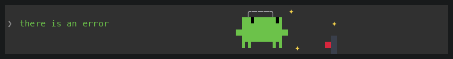<br>`error`, `bug`, `crash`: stomps a bug |
| 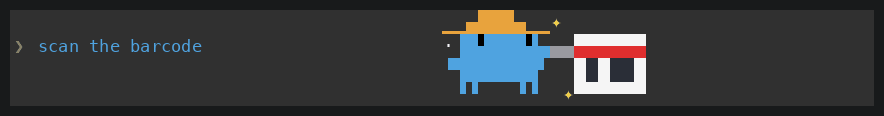<br>`scan`, `barcode`, `qr`: a laser sweeps a barcode | 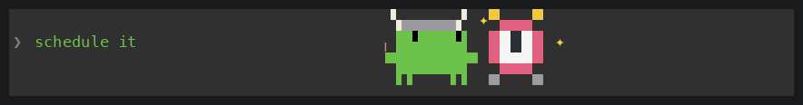<br>`time`, `schedule`, `deadline`: an alarm clock rings |
| 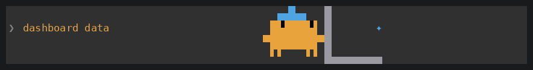<br>`data`, `dashboard`, `chart`: bars grow | 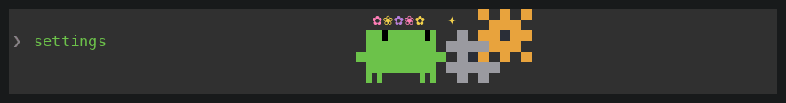<br>`settings`, `config`: gears turn |
| 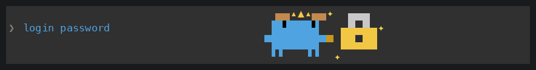<br>`login`, `password`, `security`: a key unlocks a padlock | 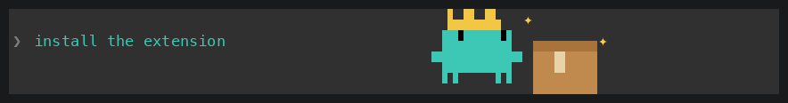<br>`install`, `extension`, `package`: a parcel opens |
| 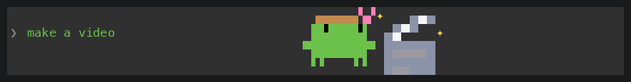<br>`video`, `animation`, `gif`: a clapperboard snaps | 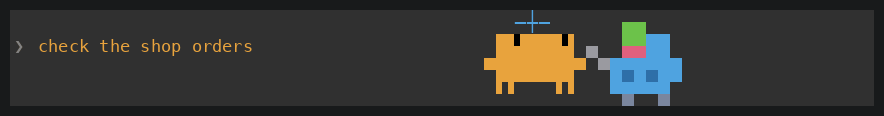<br>several topics in one prompt: one per lap, swapping with a sparkle |

### Heroes

Original hero looks (not any real character), each with its own move. Capes trail beside Clawd and badges sit above it, never on its face.

| | |
| --- | --- |
| 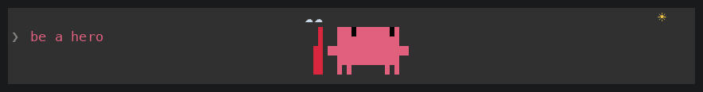<br>`hero`, `super`, `save`: Super Clawd flies, cape streaming | 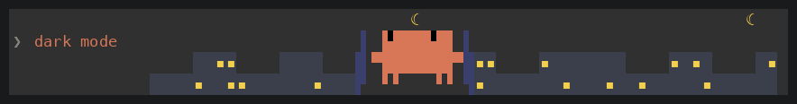<br>`dark`, `shadow`, `midnight`: night hero on a rooftop, cape flaring |
| <br>`fast`, `quick`, `asap`: speedster dashes with speed lines | <br>`jump`, `parkour`, `climb`: vaults over a crate |
| <br>`fly`, `hover`, `jetpack`: space ranger on jetpack flames | <br>`robot`, `automate`, `agent`: Robo Clawd dances |

### Tricks

Taken from Claude Code's own Clawd animations: jump, skip, spin, peekaboo, drop, waddle, look, wink, boop, tap, sneeze, turn, coin-hop, plus wave, shiver, moonwalk, bounce, doze, dab, cartwheel, flip, pogo, slide, tiptoe, sleepwalk, nod, yawn, hiccup, wiggle, duck, salute, shrug and stomp (34 in all).


### Looks

Every prompt's Clawd wears something different: 27 headwear looks or none. Some topics pick it (christmas → santa, pirate → pirate, magic → wizard, cook → chef, ninja → ninja, learn → graduation cap, birthday → party hat). Whatever Clawd holds or wears never shares its color: the item keeps its natural color and Clawd picks one that stands apart.

About a third of Clawds also wear a very small earring against the left side of the head: a gold or silver stud, a gold hoop or a pink drop.

Type `hats`, `outfits` or `fashion` for a fashion show: Clawd twirls on the spot and models a new hat every second.


### Notes

- Needs a Claude Code build with mods support. It does not load where an organization policy sets `allowManagedHooksOnly`.
- Terminal only for now. Only prompts you typed get a Clawd; task notifications and other messages keep the default look.
- Each prompt row is four lines tall: Clawd plus a row of air for jumps, hats, thought bubbles and the ball. The prompt text takes its Clawd's color.
- A prompt's look comes from its text, so the same prompt always looks the same.
- In the terminal's normal (non-fullscreen) view, prompts that have scrolled into the history may stop moving. Fullscreen animates every prompt on screen.
- The GIFs are rendered from the mod's own frames.

## eta

An accurate ETA for Claude's current work, measured from its progress, and nothing else on the line. Plus done pings and background `side:` tasks. [Details →](eta/)


## fold

Fold Claude's answers: every answer of two lines or more ends in a `▾ fold` link that shrinks it to its first lines (`▸ N more lines` opens it), and `/fold` and `/unfold` do every answer at once. [Details →](fold/)
