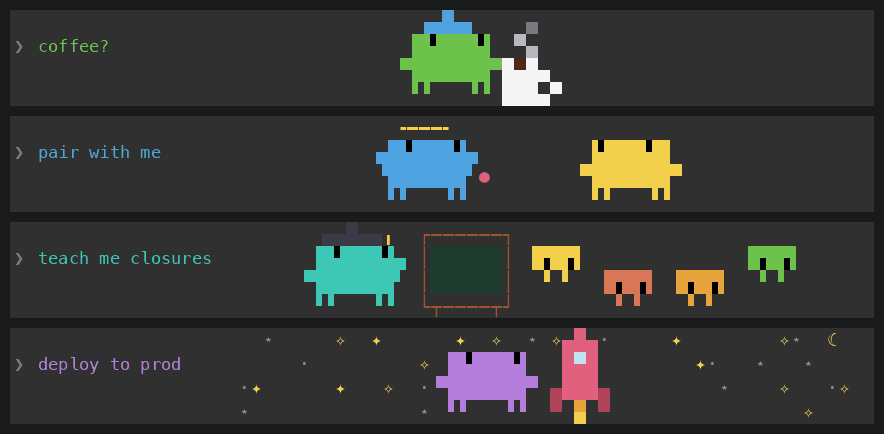
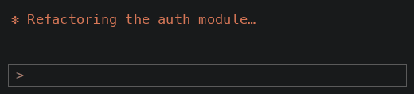

# claude-mods

Claude Code mods by Niket.

## buddy

Clawd lives on every prompt you type: its own color, its own hat, and something to do that fits what you asked. 
[More →](buddy/)



## eta

An accurate ETA for Claude's current work, measured from its progress, and nothing else on the line. Plus done pings and background `side:` tasks. [More →](eta/)



## Install

```
/plugin install buddy --marketplace niketmittal/claude-mods
/plugin install eta --marketplace niketmittal/claude-mods
```
