# buddy

Clawd, the block mascot from Claude Code's welcome screen, lives on every prompt you type. Each prompt gets its own Clawd: its own color, its own hat, and something to do that fits what you asked. Scrolling back through a long session, your prompts are easy to spot.

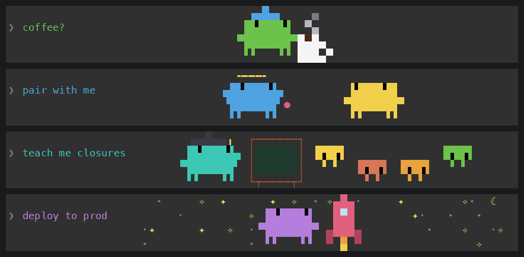

## What Clawd does

The moment you send a prompt, its Clawd starts on the activity that fits it. Then it walks the row, turns around, does one of Claude Code's own Clawd tricks on the way back, and starts the next lap.

| | |
| --- | --- |
| 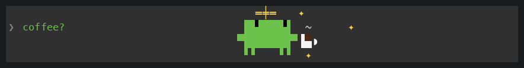<br>`coffee`, `morning`: sips from a mug | 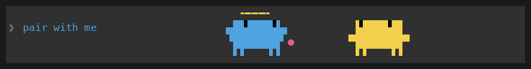<br>`pair`, `play`, `collab`: plays catch with a friend |
| 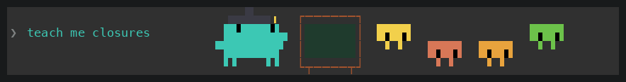<br>`teach`, `explain`, `learn`: teaches a class of tiny Clawds | 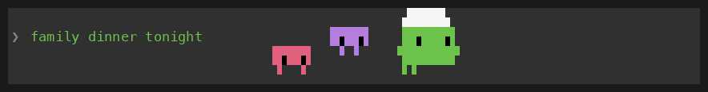<br>`family`, `team`, `friends`: two tiny Clawds hop along behind |
| 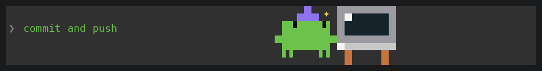<br>`git`, `commit`, `push`, `PR`: types code on a laptop | 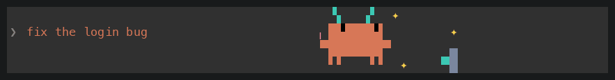<br>`fix`, `build`, `add`, `refactor`: hammers a nail into a board |
| 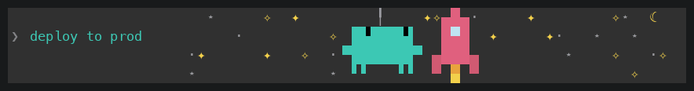<br>`deploy`, `ship`, `release`, `space`: launches a rocket | 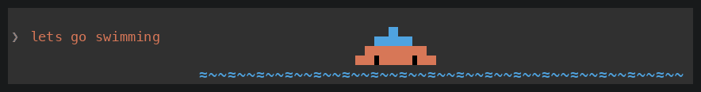<br>`swim`, `beach`, `water`: swims through waves |
| 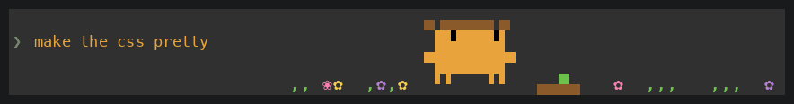<br>`design`, `css`, `pretty`, `garden`: grows a flower | 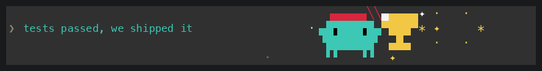<br>`passed`, `merged`, `shipped`, `done`: trophy and fireworks |
| 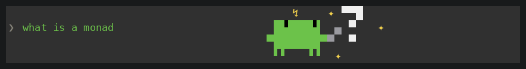<br>a question: a thought bubble goes ? → … → ! | 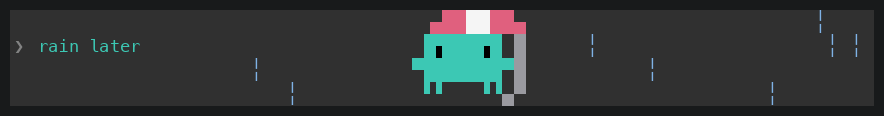<br>`rain`, `storm`: an umbrella over its head |
| 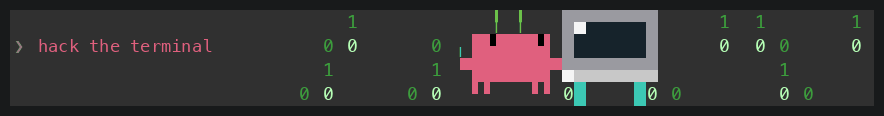<br>`code`, `hack`, `terminal`: falling matrix code | 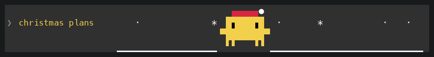<br>`christmas`, `snow`: santa hat in the snow |

More topics: `read`/`docs` (a book with turning pages), `guitar`/`song`, `screenshot`/`photo` (a camera flash), `cook`/`recipe` (a pancake flip, chef hat), `birthday` (a balloon and party hat), `love`/`<3` (rising hearts), `server`/`docker`/`k8s` (a city skyline), `fish`/`dive` (underwater), `sleep`/`later` (naps under the moon), `sun`/`vacation` (a sombrero in the sun). A prompt with no topic gets a new activity, scene and sometimes a crew every lap.

### Tricks

Taken from Claude Code's own Clawd animations: jump, skip, spin, peekaboo, drop, waddle, look, wink, boop, tap, sneeze, turn, coin-hop, plus wave, shiver, moonwalk, bounce, doze and dab.

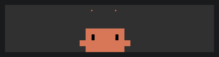

### Looks

Every prompt's Clawd wears something different: 27 headwear looks or none. Some topics pick it (christmas → santa, pirate → pirate, wizard/magic → wizard, cook → chef, ninja → ninja, learn → graduation cap, birthday → party hat).


## Install

```
/plugin install buddy --marketplace niketmittal/claude-mods
```

## Notes

- Needs a Claude Code build with mods support. It does not load where an organization policy sets `allowManagedHooksOnly`.
- Terminal only for now. Only prompts you typed get a Clawd; task notifications and other messages keep the default look.
- Each prompt row is four lines tall: Clawd plus a row of air for jumps, hats, thought bubbles and the ball. The prompt text takes its Clawd's color.
- A prompt's color and look come from its text, so the same prompt always looks the same.
- In the terminal's normal (non-fullscreen) view, prompts that have scrolled into the history may stop moving. Fullscreen animates every prompt on screen.
- The GIFs here are rendered from the mod's own frames.

## Develop

```
claude plugin validate buddy
claude plugin test buddy
```
