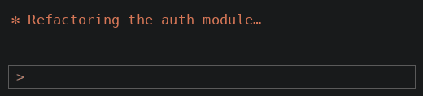

# eta — a Claude Code mod

Know how long Claude's current work will take, so you can wait, step away, or start something else without disturbing the main thread.



Just the time, nothing else, and only once there is evidence for it.

- **Measured, not guessed.** Claude plans multi-step work as a few steps (or a todo list) and marks each step as it starts. Once one is done, the ETA is the measured pace of the finished steps times the steps left, and it gets sharper with every step.
- **Claude's own estimate, corrected.** Claude's minute estimates are only used once at least 3 past turns show how far off they usually run, and then scaled by that (say ×1.8). With progress available, the ETA leans more on measured pace as more of the plan is done.
- **Nothing shown until it can be right.** No quick guesses: on a new install the line appears after the first step finishes.
- **Notifies you** when a turn that took more than 90 seconds finishes.
- **Side tasks:** type `side: <task>` while Claude is busy. It runs in a background agent without touching the main conversation, and you get a notification with the result when it's done. `/side <task>` works too, though typed mid-turn it may wait until the turn ends.

## Install

At the prompt of a Claude Code terminal session:

```
/plugin install eta --marketplace niketmittal/claude-mods
```

Answer `y` to add the marketplace, then choose a scope (user = every session). It's active immediately.

Requires a Claude Code build with mods (function hooks) support. Mods won't load if a managed policy sets `allowManagedHooksOnly: true`.

## Notes

- Side agents share your working directory. Give them research or read-only work, not edits to files the main thread is changing.
- Short answers show no ETA: Claude skips the plan for anything under about a minute.

## Develop

```
claude plugin validate eta
claude plugin test eta
```
